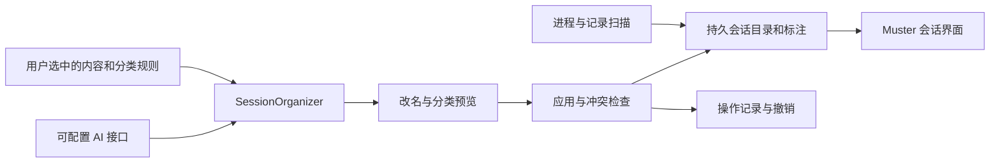

# kk-sessions 源码研究与 Muster 接入评估

研究日期：2026-11-14。上游仓库：[kkfor30/kk-sessions](https://github.com/kkfor30/kk-sessions)。本次固定分析 [commit 8c34f7e](https://github.com/kkfor30/kk-sessions/tree/8c34f7efa52b8c2f46e1cdcbeb3c622a810d0bb1)，提交日期 2026-11-13，插件清单版本为 0.3.0。

本次读取了源码、四份 Skill、Hook 配置、许可证和验证清单。没有安装插件、运行上游 Hook、调用其模型或修改真实侧栏。回退规划中的两项问题另用合成数据复现，方法见下文。README 中的延迟、token 用量和桌面即时刷新描述属于作者报告，未在这台机器复测。

## 这个仓库解决什么问题

kk-sessions 把“会话标题、侧栏领域分区、产物存放目录”放进同一套约定。它通过 Skill 指示会话模型处理目录与归类，并由 Hook 在会话启动、用户发言和回复结束时补充提示或触发后台归类。实现由 Markdown、Python 标准库脚本和两种 Agent 的插件清单组成；它没有独立的桌面 UI，也没有可直接复用的 Swift SDK。[插件清单](https://github.com/kkfor30/kk-sessions/blob/8c34f7efa52b8c2f46e1cdcbeb3c622a810d0bb1/.codex-plugin/plugin.json)、[脚本目录](https://github.com/kkfor30/kk-sessions/tree/8c34f7efa52b8c2f46e1cdcbeb3c622a810d0bb1/skills/kk-session-route/scripts)

四个 Skill 的职责如下：

| 功能 | 实际行为 | 来源 |
| --- | --- | --- |
| 初始化 | 查看现有会话标题、工作目录和分区，提出领域分区与产物目录，用户确认后写地图并对齐侧栏 | [kk-session-setup](https://github.com/kkfor30/kk-sessions/blob/8c34f7efa52b8c2f46e1cdcbeb3c622a810d0bb1/skills/kk-session-setup/SKILL.md) |
| 新会话归类 | 按地图确定主题目录，必要时建 README，生成标题并移入分区；不同 Agent 的实际执行方式不同 | [kk-session-route](https://github.com/kkfor30/kk-sessions/blob/8c34f7efa52b8c2f46e1cdcbeb3c622a810d0bb1/skills/kk-session-route/SKILL.md) |
| 整理旧会话 | 给出标题格式、分区和阶段改名建议；列出等待用户推进的会话；默认先展示建议再执行 | [kk-session-tidy](https://github.com/kkfor30/kk-sessions/blob/8c34f7efa52b8c2f46e1cdcbeb3c622a810d0bb1/skills/kk-session-tidy/SKILL.md) |
| 恢复 | 读取最早快照，计算标题、分区名、归属和分区删除计划，预览后执行 | [kk-session-restore](https://github.com/kkfor30/kk-sessions/blob/8c34f7efa52b8c2f46e1cdcbeb3c622a810d0bb1/skills/kk-session-restore/SKILL.md) |

共享规则来源是 `~/.agent-rules/workspace-map.md`。地图记录分区、产物目录、放什么和判定线索；标题格式是“任务类型 + 主题 + 本次工作”。主题默认锁定，阶段改名需要提出建议。标题末尾的 `⏳` 表示仍有必须由用户完成的动作，例如选择方案或补材料；它不等于进程空闲或任务完成。[地图模板](https://github.com/kkfor30/kk-sessions/blob/8c34f7efa52b8c2f46e1cdcbeb3c622a810d0bb1/skills/kk-session-setup/workspace-map.template.md)

## 两条执行链

### Claude Code

- `SessionStart` 注入路由提示，由会话模型调用 Skill 和桌面工具完成改名、归区与目录处理。
- `UserPromptSubmit` 读取当前标题并提醒维护 `⏳`。
- `Stop` 检查第一轮是否已有规范标题；只对 `claude-desktop` 生效，未归类时阻拦一次以要求补做。脚本跳过 `stop_hook_active`，避免反复阻拦。

这条链依赖宿主给会话提供的工具。Skill 列出的改名、分区和目录能力来自 `mcp__ccd_*`；Muster 作为独立应用不能仅复制这些工具名称就获得能力。[Hook 定义](https://github.com/kkfor30/kk-sessions/blob/8c34f7efa52b8c2f46e1cdcbeb3c622a810d0bb1/hooks/hooks.json)、[收尾检查](https://github.com/kkfor30/kk-sessions/blob/8c34f7efa52b8c2f46e1cdcbeb3c622a810d0bb1/skills/kk-session-route/scripts/stop_check.py#L45-L63)、[Claude 适配说明](https://github.com/kkfor30/kk-sessions/blob/8c34f7efa52b8c2f46e1cdcbeb3c622a810d0bb1/skills/kk-session-route/SKILL.md#L75-L86)

### Codex

`SessionStart` 负责告诉会话模型如何安排产物目录；标题和分区交给 `Stop` 触发的独立 Python worker。worker 通过 `codex app-server` 读取会话，调用模型得出结构化建议，再尝试写回标题和分区。超过三轮、已有规范标题、子会话、临时会话、自动化和 exec 派发会话会被跳过；仅打招呼时等待后续内容。[Hook 定义](https://github.com/kkfor30/kk-sessions/blob/8c34f7efa52b8c2f46e1cdcbeb3c622a810d0bb1/hooks/codex.json)、[启动说明](https://github.com/kkfor30/kk-sessions/blob/8c34f7efa52b8c2f46e1cdcbeb3c622a810d0bb1/skills/kk-session-route/scripts/session_start.py)、[归类条件](https://github.com/kkfor30/kk-sessions/blob/8c34f7efa52b8c2f46e1cdcbeb3c622a810d0bb1/skills/kk-session-route/scripts/codex_route.py#L441-L470)

后台 AI 的调用方式是：

```text
Python worker
  → codex exec --ephemeral --ignore-user-config
  → JSON Schema 约束的标题、分区、waiting、新分区建议和理由
  → 写回侧栏
```

脚本通过本地 Codex CLI 的认证环境运行模型，没有实现通用的 Base URL、API Key 或 HTTP 客户端。默认模型常量为 `gpt-6-luna`、推理强度 `low`，允许用户在插件配置中覆盖；这里只确认代码默认值，不推断账号一定可用。首次尝试失败后会改用 CLI 默认模型。运行参数要求临时会话、只读沙箱，并关闭 Hook、应用、插件及多种工具。[模型调用实现](https://github.com/kkfor30/kk-sessions/blob/8c34f7efa52b8c2f46e1cdcbeb3c622a810d0bb1/skills/kk-session-route/scripts/codex_route.py#L366-L413)

返回结果包括 `section`、`title`、`waiting`、`new_section` 和 `reason`。分区不在地图列表内时转入兜底分区；新领域只留下待提议记录，下一轮交给会话模型询问用户。[输出结构](https://github.com/kkfor30/kk-sessions/blob/8c34f7efa52b8c2f46e1cdcbeb3c622a810d0bb1/skills/kk-session-route/scripts/codex_route.py#L72-L81)、[结果检查与待提议记录](https://github.com/kkfor30/kk-sessions/blob/8c34f7efa52b8c2f46e1cdcbeb3c622a810d0bb1/skills/kk-session-route/scripts/codex_route.py#L471-L521)

## 写回、目录和运行限制

**侧栏写回依赖宿主内部接口。** 首选 `DesktopTools`，通过命名管道发送带长度前缀的 JSON-RPC，调用桌面内部工具。失败时回退到启用了 `experimentalApi` 的 app-server，使用 `thread/name/set`、`threadSection/create` 和 `thread/section/move`。仓库说明回退后可能要重新加载桌面端才看到变化；本次没有验证这些接口在当前宿主版本中的实际可用性。[DesktopTools](https://github.com/kkfor30/kk-sessions/blob/8c34f7efa52b8c2f46e1cdcbeb3c622a810d0bb1/skills/kk-session-route/scripts/codex_route.py#L209-L287)、[app-server 初始化](https://github.com/kkfor30/kk-sessions/blob/8c34f7efa52b8c2f46e1cdcbeb3c622a810d0bb1/skills/kk-session-route/scripts/codex_route.py#L145-L158)、[写回回退](https://github.com/kkfor30/kk-sessions/blob/8c34f7efa52b8c2f46e1cdcbeb3c622a810d0bb1/skills/kk-session-route/scripts/codex_route.py#L497-L513)

**macOS 的即时写回链路存在静态可见的缺口。** `worker_env()` 删除 `CODEX_APP_TOOLS_PIPE_PATH`，Hook 启动 worker 时使用的正是该环境；`DesktopTools.pipes()` 在非 Windows 上只从这个环境变量取管道路径。按正常 Stop → worker 链路推导，macOS worker 找不到桌面管道，会进入 app-server 回退。Windows 另有枚举命名管道逻辑。不能把 README 中“侧栏立即刷新”当作已验证的 macOS 行为。[环境清理](https://github.com/kkfor30/kk-sessions/blob/8c34f7efa52b8c2f46e1cdcbeb3c622a810d0bb1/skills/kk-session-route/scripts/codex_route.py#L135-L140)、[管道发现](https://github.com/kkfor30/kk-sessions/blob/8c34f7efa52b8c2f46e1cdcbeb3c622a810d0bb1/skills/kk-session-route/scripts/codex_route.py#L216-L226)、[worker 启动](https://github.com/kkfor30/kk-sessions/blob/8c34f7efa52b8c2f46e1cdcbeb3c622a810d0bb1/skills/kk-session-route/scripts/codex_route.py#L564-L571)

**目录路由与改变会话 cwd 是两件事。** 路由 Skill 要求会话模型把文件写到地图指定的绝对路径，并为新主题建立 README。Claude 的切目录通过桌面工具、经用户批准后生效；仓库把 Codex 切目录明确降级为用户手动拖动项目。Codex 后台 worker 只改标题和分区，不创建产物目录，也不改 cwd。因此复制 worker 并不能自动保证产物归档。[目录处理](https://github.com/kkfor30/kk-sessions/blob/8c34f7efa52b8c2f46e1cdcbeb3c622a810d0bb1/skills/kk-session-route/SKILL.md#L31-L54)、[Codex 能力降级](https://github.com/kkfor30/kk-sessions/blob/8c34f7efa52b8c2f46e1cdcbeb3c622a810d0bb1/skills/kk-session-route/SKILL.md#L88-L104)

**默认目录写死在多个脚本中。** 安装脚本使用 `Path.home() / ".claude"` 和 `Path.home() / ".codex"`；每轮提醒直接从 `~/.codex/state_*.sqlite` 只读查询标题。没有统一采用 Muster 的 `AgentRegistry` 环境变量路径解析，接入自定义 `CODEX_HOME` 等目录时需要改造。[安装路径](https://github.com/kkfor30/kk-sessions/blob/8c34f7efa52b8c2f46e1cdcbeb3c622a810d0bb1/install.py#L21-L42)、[只读数据库查询](https://github.com/kkfor30/kk-sessions/blob/8c34f7efa52b8c2f46e1cdcbeb3c622a810d0bb1/skills/kk-session-route/scripts/turn_hint.py#L56-L74)

## 上下文、日志和重试

Codex worker 发给模型的上下文含地图前 6000 字符、分区名列表、cwd，以及新会话前三轮内每轮用户消息的前 1200 字符和助手最终回答的末 800 字符。它确实会处理对话正文，和 Muster 当前只读会话元数据的方式不同。日志包含生成后的标题、分区、理由、用量或错误片段；快照只记录标题、归属和归档状态。[上下文构造](https://github.com/kkfor30/kk-sessions/blob/8c34f7efa52b8c2f46e1cdcbeb3c622a810d0bb1/skills/kk-session-route/scripts/codex_route.py#L459-L470)、[结果日志字段](https://github.com/kkfor30/kk-sessions/blob/8c34f7efa52b8c2f46e1cdcbeb3c622a810d0bb1/skills/kk-session-route/scripts/codex_route.py#L519-L540)、[快照字段](https://github.com/kkfor30/kk-sessions/blob/8c34f7efa52b8c2f46e1cdcbeb3c622a810d0bb1/skills/kk-session-route/scripts/codex_route.py#L418-L436)

重试有三层，不能按“一次归类等于一次模型调用”估算硬上限：

- 每次 `ask_model` 最多运行两次 CLI，每次超时 60 秒。
- worker 收到异常后等待 60 秒，再跑一次路由。
- Hook 记录每会话尝试数，最多启动五次 worker；成功或决定跳过后写 done 标记。

这是源码限制，不是实测计费结果。Hook 的计数与 worker 启动没有看到互斥锁；快速连续回合可能有重叠 worker，接入时应增加按会话去重和请求取消。[模型重试](https://github.com/kkfor30/kk-sessions/blob/8c34f7efa52b8c2f46e1cdcbeb3c622a810d0bb1/skills/kk-session-route/scripts/codex_route.py#L392-L413)、[worker 与 Hook](https://github.com/kkfor30/kk-sessions/blob/8c34f7efa52b8c2f46e1cdcbeb3c622a810d0bb1/skills/kk-session-route/scripts/codex_route.py#L524-L574)

## 快照恢复值得借鉴，具体判定需要重写

仓库提供恢复预览、首次快照和恢复前快照。恢复工具会复制到插件目录之外，便于停用插件后继续使用；Codex 的恢复不调用模型，执行阶段依赖桌面工具通道。它不删除会话，也不移动磁盘目录。[恢复工具保留](https://github.com/kkfor30/kk-sessions/blob/8c34f7efa52b8c2f46e1cdcbeb3c622a810d0bb1/skills/kk-session-route/scripts/kit.py)、[恢复执行](https://github.com/kkfor30/kk-sessions/blob/8c34f7efa52b8c2f46e1cdcbeb3c622a810d0bb1/skills/kk-session-route/scripts/restore.py#L82-L145)

但“保留用户后续手动改动”目前靠启发式判断，没有逐次操作日志证明所有权：

| 情况 | 当前规划结果 | 引入 Muster 前需要的处理 |
| --- | --- | --- |
| 用户在首次快照之后手建分区 | 只要不在快照且不是名为 Pinned 的分区，就被当作新增分区列入删除 | 记录本模块实际创建的分区 ID；只处理有明确归属记录的分区 |
| 用户手动改名，但仍使用规范标题格式 | 仍符合正则，就被列入恢复原标题 | 保存 before/after 值；只有当前值仍等于本模块最后写入值时恢复 |
| 用户手动重命名已有分区 | 当前名与初始快照不同就被列入还原 | 同样检查最后写入值，冲突时跳过并展示原因 |

前两项已经用虚构快照和会话对象验证 `plan()` 的输出：从源码 AST 中只提取该纯函数运行，没有导入或运行上游模块，没有执行 `apply()`，没有触碰真实会话。第三项来自静态分支检查。[回退计划实现](https://github.com/kkfor30/kk-sessions/blob/8c34f7efa52b8c2f46e1cdcbeb3c622a810d0bb1/skills/kk-session-route/scripts/restore.py#L37-L64)

常规归类也不完全满足“保留用户选择”的文字描述：模型调用前标题非空时，写回前会比较是否被改名；原来为空时没有同样保护。分区则只要不同于模型选择就会移动，没有检查模型运行期间是否由用户手动归类。Muster 应在应用计划前重新比对目标版本，而不是仅识别标题格式。[写回前检查](https://github.com/kkfor30/kk-sessions/blob/8c34f7efa52b8c2f46e1cdcbeb3c622a810d0bb1/skills/kk-session-route/scripts/codex_route.py#L489-L513)

## 许可证和验证范围

仓库采用 MIT License，版权标注为 2026 kkfor30。许可证文本允许使用、修改和分发，条件包含在代码副本或实质性部分中保留版权与许可声明；若后续直接复用代码，应随分发包保留对应声明。[LICENSE](https://github.com/kkfor30/kk-sessions/blob/8c34f7efa52b8c2f46e1cdcbeb3c622a810d0bb1/LICENSE)

本次固定 commit 的文件树中没有发现自动化测试套件、测试框架配置或 CI 工作流。仓库提供的是需要实际安装后操作的[人工验证清单](https://github.com/kkfor30/kk-sessions/blob/8c34f7efa52b8c2f46e1cdcbeb3c622a810d0bb1/docs/%E9%AA%8C%E8%AF%81%E6%B8%85%E5%8D%95.md)。这限制了可直接移植代码的可信程度，尤其是回退、并发和宿主升级兼容性。

## 对 Muster 的适用性判断

值得吸收的是工作区地图、独立的任务等待状态、可预览的批量归类，以及按实际操作记录撤销的产品设计。Muster 可以先把这些能力做在自己的会话目录和界面内，随后再评估对原 Agent 侧栏的可选写回。

当前上游脚本与 Codex/Claude 宿主工具、Python 运行环境和固定目录紧密耦合。把整个插件直接嵌入 Muster，会增加宿主版本、路径、Hook 安装和侧栏回退的维护工作。更合适的技术路线是复用概念，在 Muster 中建立小接口的会话整理模块；AI 返回建议，持久化、冲突检查和撤销由应用代码负责。

## Muster 当前能复用什么，还缺什么

以下以 2026-11-14 的当前工作区为准，包含本次会话前几批已经完成、尚未提交的改动。仓库中旧版 `docs/IMPLEMENTATION.md` 已标为历史归档，不能据此认为当前仍存在审批 Hook 或后台协议服务。

| 当前模块 | 已有能力 | 引入会话整理时需要补充 |
| --- | --- | --- |
| [AgentRegistry](/Users/ethan/Code/muster/Sources/MusterCore/Agents/AgentRegistry.swift:17) | 集中定义进程识别、记录路径、规则和配置能力 | 内容读取能力要随实际适配增加；用户自定义分类应存到用户数据中 |
| [Session](/Users/ethan/Code/muster/Sources/MusterCore/Model/Session.swift:17) | Agent、会话 ID、cwd、进程身份、时间与活动状态 | 持久化标题、分类、关注状态和产物目录关联；采用独立标注记录，避免扫描覆盖用户选择 |
| [TranscriptScanner](/Users/ethan/Code/muster/Sources/MusterCore/Adapters/TranscriptScanner.swift:13) | 读取文件首尾各至多 64 KiB，只解析 ID、目录和时间 | AI 命名需要单独的限量内容读取；现有扫描结果不能判断对话主题 |
| [SessionPolicy](/Users/ethan/Code/muster/Sources/MusterCore/Sessions/SessionPolicy.swift:5)、[PanelModel](/Users/ethan/Code/muster/Sources/Muster/PanelModel.swift:139) | 默认扫描最近 24 小时的记录；无存活进程且长时间无活动会变为 ended，页面过滤 ended | 历史会话要建立独立目录和索引；标注不能随运行状态或扫描保留期消失 |
| [SessionBrowser](/Users/ethan/Code/muster/Sources/MusterCore/Sessions/SessionBrowser.swift:3) | 按 Agent、完整项目路径分组；搜索和活动筛选 | 增加按用户分类分组，搜索标题，筛选未分类和待处理 |
| [ManagementWindowController](/Users/ethan/Code/muster/Sources/Muster/ManagementWindowController.swift:44) | 独立可调整大小的管理窗口 | 承载历史列表、分类导航、详情和批量预览 |
| [InstructionSync](/Users/ethan/Code/muster/Sources/MusterCore/Instructions/InstructionSync.swift:239) | 先生成预览，再比对原文件后应用，并保留备份 | 可以沿用这种交互和冲突检查方式，不能直接用规则文件写入实现去修改会话 |

项目当前使用 SwiftUI / AppKit、SwiftPM，未引入第三方包。会话整理的本地存储和 UI 可以沿用现有技术栈。AI HTTP 客户端仍只是此前讨论的方案，当前源码没有实现它；也不能把已有的 Agent 默认模型配置页当作 Muster 自己的 AI 接口设置。[Package.swift](/Users/ethan/Code/muster/Package.swift:4)、[AgentConfiguration](/Users/ethan/Code/muster/Sources/MusterCore/Configuration/AgentConfiguration.swift:47)

## 建议的接入顺序

| 阶段 | 交付内容 | 完成标准 |
| --- | --- | --- |
| P0：Muster 内会话管理 | 持久化会话目录、手动标题、自定义分类、待处理标记、目录关联、撤销 | 重启后保留标注；会话结束后仍可在历史中找到；不改变原 Agent 的侧栏 |
| P1：AI 整理建议 | 可配置 AI 接口、连接测试、选中会话的命名与分类建议、等待用户的提示、批量预览 | 只应用用户选中的建议；输入变化或用户编辑后拒绝过期结果；请求可取消、可重试、有用量反馈 |
| P2：可选外部联动 | 工作区地图导入/导出、可选配套插件、经验证的宿主标题和分区同步 | 每个宿主明确支持范围；接口不可用时保留本地结果和手动操作提示；有真实变更日志和冲突感知回退 |

P0 可以在没有模型账号时使用。P1 建议先做用户主动点击的“智能整理”，验收质量与开销后再增加新会话自动整理。Muster 每 15 秒扫描一次会话；扫描不应直接触发每个会话一次模型调用。请求应按稳定会话 ID、所选内容版本和分类规则版本去重，并限制并发、重试和总输入长度。

历史导入先支持已有适配的 Claude Code、Codex、Pi。只有进程信息的会话缺少可持久使用的对话 ID 和正文，可以按项目路径展示临时分组，但不能把 PID 当作跨重启的会话标识。历史列表提供“继续会话”和目录入口；已退出进程不应显示为仍可聚焦的终端。

界面上保留菜单栏面板作为近期会话入口，把完整管理放在独立窗口：

- 会话区域提供“近期 / 历史”范围，以及“全部 / 待处理 / 未分类”和用户自建分类。
- 行首显示可读标题，下一行放 Agent、项目目录和分支；活动状态与“等我处理”分别展示。
- 详情中展示关联目录、用户备注、建议理由和最近一次整理记录。关联产物目录与实际 cwd 使用不同字段。
- 选中多条后点击“智能整理”，查看旧值、新值和理由，逐项采纳；提交后可撤销该次操作。

## 建议的实现接口

会话扫描继续负责读取事实，新增 `SessionCatalog` 保存持久身份与用户标注。`SessionOrganizer` 对 UI 暴露生成计划、应用计划、撤销三个操作；模型请求、输入裁剪、结果校验和冲突检查放在实现内部。先落实一个可用的 AI 接口实现，出现第二种真实协议差异后再拆适配器。



`SessionCatalog` 至少需要保存稳定会话身份、显示标题、分类 ID、关注状态、产物目录、字段来源和修订号。现有 `running / idle / unknown / ended` 继续表示进程和记录活动；另外保存 `needsUser / none / unknown` 等关注状态，并记录它来自用户还是模型。“暂无新活动”不能直接转换成“等待用户”，也不能据此推断任务已完成。

标题与分类通常需要开头的有限内容；判断是否等待用户则更依赖最近一轮。读取内容前明确选择范围，发送前去除可识别的凭证，默认不上传整个仓库或完整会话。AI 返回结构化建议和依据；分类必须匹配已存在的分类 ID，新分类另作提议。会话正文只作为待分析数据，不让正文中的指令触发命令、写文件或改目录。

应用计划时记录目标字段的 before / after、实际创建的对象 ID 和版本。撤销时仅恢复“当前值仍等于本次写入值”的字段，用户后来改动的字段跳过并提示。删除分类还需要确认它由本次操作创建，且没有新增归属；不能通过“初始快照里不存在”推断创建者。

本地标注保存在 Muster 自己的 Application Support 目录。已有工作区地图可作为显式导入源，导入时展示字段映射；后续导出或同步需要冲突提示，避免 Markdown 地图和本地配置各自更新却互相覆盖。目录规则只决定推荐或关联位置，自动生成文件仍需宿主内的 Skill 或插件配合，不能靠扫描器控制其他应用的写入。

最低验收应覆盖：应用重启、进程退出和历史扫描后标注不丢失；同目录多会话不串标题；进程临时身份不进入永久索引；模型输出非法分类被拒绝；用户编辑后过期建议不覆盖；取消和失败不产生半份变更；撤销保留手动改动及用户后建分类；重复扫描不重复收费。外部写回另设兼容性验收，不作为本地整理功能可用的前提。
